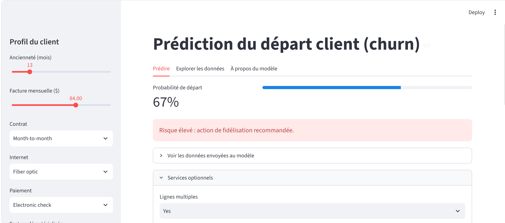

# Prédiction du churn client — Random Forest + Streamlit
[Application en ligne](https://churn-radar-randomforest.streamlit.app/)  
## Problème
Un opérateur télécom veut identifier les clients susceptibles de résilier
pour déclencher une action de fidélisation. Données : IBM Telco (7 043 clients).
## Résultats
Évaluation sur un jeu de test de 1 409 clients (27 % de churn), utilisé une seule fois.

| Modèle | ROC AUC (test) | Recall (churn) | Precision (churn) | F1 (churn) |
|---|---|---|---|---|
| Arbre de décision (élagué) |  | 0.79 | 0.51 | 0.62 |
| Random Forest (tunée) | 0.845 | 0.791 | n/d | 0.629 |

La Random Forest obtient un ROC AUC de 0.845 en test, cohérent avec 0.848 en validation croisée à 5 plis (pas de surapprentissage visible).

Hyperparamètres retenus : `n_estimators=437`, `max_depth=10`, `min_samples_leaf=16`,
`min_samples_split=14`, `max_features="sqrt"`, `class_weight="balanced"`.

Variables les plus influentes : contrat, ancienneté, facture mensuelle...
## Démarche
1. EDA : déséquilibre de classes (27 % de churn), piège sur TotalCharges
2. Preprocessing : ColumnTransformer + Pipeline (aucune fuite de données)
3. Arbre de décision : étude du surapprentissage
4. Random Forest : RandomizedSearchCV, validation croisée à 5 plis
5. Application Streamlit : prédiction individuelle et exploration
## Lancer le projet
```bash
git clone ---
cd churn-prediction
python -m venv .venv && source .venv\Scripts\activate
pip install -r requirements.txt
python -m src.train # entraîne et sauvegarde le modèle
streamlit run app.py
```
## Limites et pistes d'amélioration
- Données d'exemple fournies par IBM : à valider sur des données réelles
- Seuil de décision à calibrer selon le coût métier réel
- Tester XGBoost / LightGBM, expliquer avec SHAP